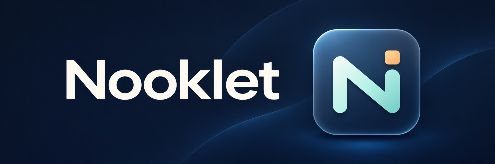
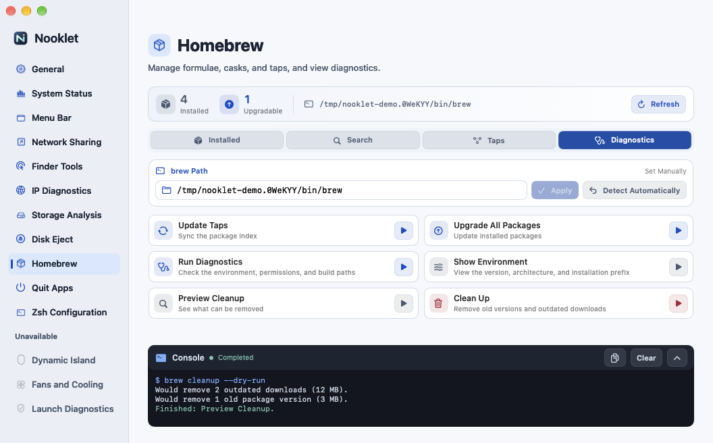
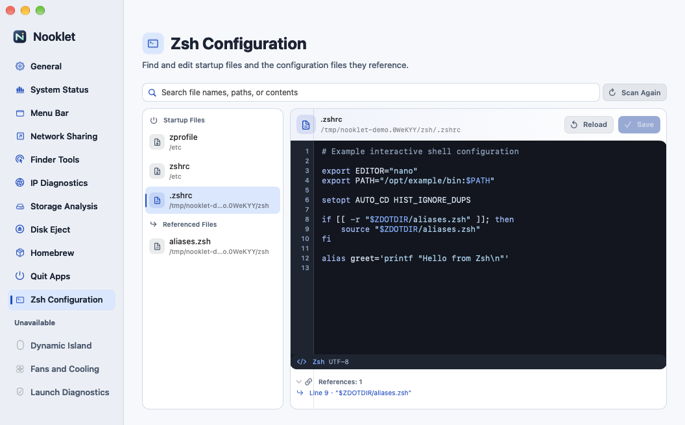

<h1 align="center">
  
</h1>

<p align="center">
  <strong>A native macOS menu bar toolkit.</strong><br>
  Check system activity, handle everyday Mac tasks, and manage your developer setup.
</p>

<p align="center">
  macOS 14+ &nbsp;·&nbsp; Swift &nbsp;·&nbsp; <a href="LICENSE">MIT</a>
</p>

<p align="center">
  <a href="#quick-start"><strong>Quick start</strong></a> &nbsp;·&nbsp;
  <a href="#features">Features</a> &nbsp;·&nbsp;
  <a href="#build-from-source">Build from source</a> &nbsp;·&nbsp;
  <a href="README.zh-CN.md">简体中文</a>
</p>

## See it in action

<table>
  <tr>
    <td width="50%" valign="top">
      <a href="docs/screenshots/homebrew.png"></a>
      <strong>Homebrew diagnostics</strong><br>
      Browse packages, run checks, and preview cleanup in the console.
    </td>
    <td width="50%" valign="top">
      <a href="docs/screenshots/zsh.png"></a>
      <strong>Zsh configuration</strong><br>
      Find startup files, follow their references, and edit them in place.
    </td>
  </tr>
</table>

<sub>Click either screenshot to view it at full size. Both use example data.</sub>

## Quick start

Download the Apple silicon DMG from [GitHub Releases](https://github.com/jinwang-aibai/Nooklet/releases), drag **Nooklet.app** into **Applications**, and launch it. To make a local DMG, follow the [build instructions](#build-from-source).

- **Click** the cat icon in the menu bar to open System Status.
- **Right-click** the icon and choose **Open Nooklet Settings…** for the full toolbox. You can also press **⌘,** while Nooklet is active.
- **Change the language** under **General → Language**, then restart Nooklet. The interface supports English and Simplified Chinese.
- **Check for updates** under **General → Software Update** or from the menu bar icon’s context menu. If an update is available, open its GitHub release to read the notes and download it.

## Features

### Monitor and organize

- **System Status** shows CPU, GPU, memory, storage, network, battery, and processes. Arrange the dashboard widgets, add live menu bar indicators, and enable the calendar.
- **Menu Bar** groups app icons by when they should appear. Preview your arrangement before applying it. macOS requires Accessibility permission for this feature.
- **Quit Apps** quits an app and its listed helpers as a group. Expand a group to quit an individual item.

### Work with files and networks

- **Finder Tools** creates common file types, copies paths, opens a folder in Terminal, and opens items with an app you choose. Enable the Finder extension from **Finder Tools → Open Extension Settings…**.
- **Storage Analysis** displays disk usage as a treemap and ranked list. Drill into folders and review items before moving them to the Trash.
- **Disk Eject** ejects an external volume or disk image, or ejects all eligible volumes in one action.
- **Network Sharing** serves files, folders, or text to devices on the local network. Share the address or its QR code.
- **IP Diagnostics** inspects local addresses and runs public IP, speed, connectivity, WebRTC, and DNS checks on demand.

### Maintain your developer setup

- **Homebrew** searches formulae and casks, manages packages and taps, and runs maintenance commands in a live console. Install Homebrew separately and set a custom `brew` path in **Diagnostics** if needed.
- **Zsh Configuration** follows references from startup files and searches across their contents. The editor highlights syntax, shows line numbers, and checks syntax before saving.

## Build from source

Use macOS 14 or later with Swift 6 and the Xcode Command Line Tools. Run these commands from the project root.

```sh
swift run NookletChecks
./scripts/build-app.sh
open .build/app/Nooklet.app
```

Run `./scripts/build-dmg.sh` to package the app in `.build/distribution/`. Pass an output directory to save it elsewhere. The scripts use a local development signature by default. Set `NOOKLET_SIGNING_IDENTITY` to select a signing identity from your keychain.

<details>
<summary>Local development and network sharing tests</summary>

```sh
NOOKLET_DATA_DIR=/tmp/nooklet-dev swift run Nooklet --show-window
swift run NookletChecks --lan-share
```

`NOOKLET_DATA_DIR` isolates preferences and plug-ins from your regular Nooklet installation.

</details>

## Data and permissions

Nooklet keeps preferences and plug-in manifests in `~/Library/Application Support/Nooklet/`. It can reuse an older LiteBox data folder when the Nooklet folder is absent. Network Sharing runs after you enable it and stops when you turn it off or quit Nooklet. External IP checks contact their services when invoked. Software Update contacts GitHub when you click **Check for Updates**. Calendar events require calendar permission.

## Project resources

Use **Import Local Plug-in…** from the menu bar context menu to load a `.plugin` directory or `manifest.json`. Updates keep the same ID and template and use a higher version. [Example plug-in](Examples/CompactStatus.plugin/manifest.json) · [Plug-in contract](docs/PLUGIN_CONTRACT.md) · [Performance notes](docs/PERFORMANCE.md)

## License

Nooklet's original code and documentation are available under the [MIT License](LICENSE). The bundled RunCat animation frames retain their [Apache 2.0 license](Sources/Nooklet/Resources/RunCat/LICENSE) and [upstream attribution](Sources/Nooklet/Resources/RunCat/NOTICE.txt).
