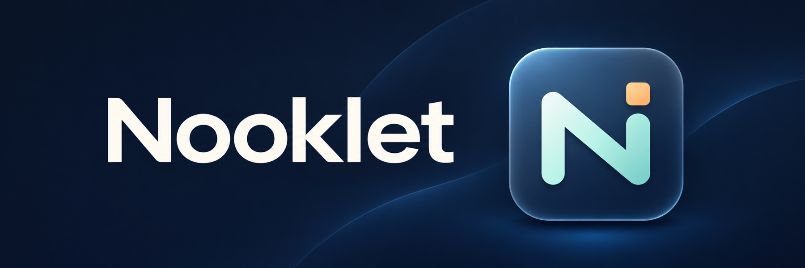
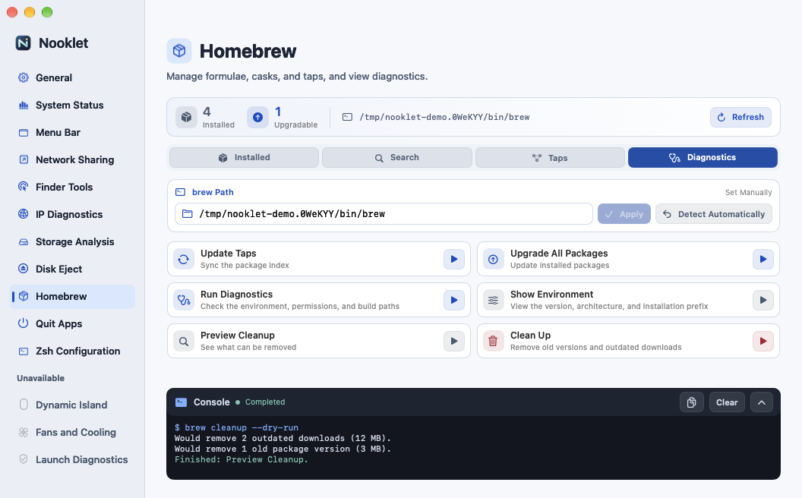
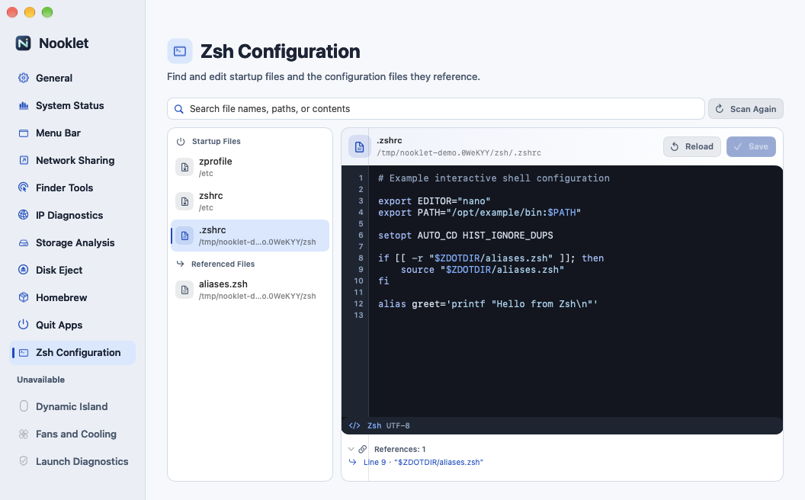

<h1 align="center">
  
</h1>

<p align="center">
  <strong>原生 macOS 菜单栏工具箱。</strong><br>
  查看系统状态、处理日常文件操作，并管理开发环境。
</p>

<p align="center">
  macOS 14+ &nbsp;·&nbsp; Swift &nbsp;·&nbsp; <a href="LICENSE">MIT</a>
</p>

<p align="center">
  <a href="#快速开始"><strong>快速开始</strong></a> &nbsp;·&nbsp;
  <a href="#功能">功能</a> &nbsp;·&nbsp;
  <a href="#从源码构建">从源码构建</a> &nbsp;·&nbsp;
  <a href="README.md">English</a>
</p>

## 界面预览

<table>
  <tr>
    <td width="50%" valign="top">
      <a href="docs/screenshots/homebrew.png"></a>
      <strong>Homebrew 诊断</strong><br>
      浏览软件包、运行环境检查，在控制台预览缓存清理。
    </td>
    <td width="50%" valign="top">
      <a href="docs/screenshots/zsh.png"></a>
      <strong>Zsh 配置</strong><br>
      找到启动文件及其引用的配置，在同一个窗口里编辑。
    </td>
  </tr>
</table>

<sub>点击图片查看原尺寸。两张截图均使用示例数据。</sub>

## 快速开始

从 [GitHub Releases](https://github.com/jinwang-aibai/Nooklet/releases) 下载 Apple 芯片版 DMG，把 **Nooklet.app** 拖到「应用程序」，再从该目录启动。也可以[从源码构建](#从源码构建)本地 DMG。

- **单击**菜单栏小猫图标，查看系统状态。
- **右键点击**图标并选择「打开 Nooklet 设置…」，或在 Nooklet 激活时按 **⌘,**，打开完整工具箱。
- **切换界面语言**可在「基础信息 → 语言」选择简体中文或英文，重启 Nooklet 后生效。
- **检查更新**可在「基础信息 → 版本更新」或菜单栏图标的右键菜单中运行。有新版时可前往 GitHub 查看发布说明并下载安装包。

## 功能

### 系统与菜单栏

- **系统状态**显示 CPU、GPU、内存、磁盘、网络、电池和进程。可以重排面板组件、添加菜单栏实时指标，以及启用月历。
- **菜单栏管理**按显示时机整理应用图标，支持先预览排列再应用。此功能需要 macOS 辅助功能权限。
- **退出应用**按软件分组退出应用及其列出的辅助程序。展开分组后可单独退出某一项。

### 文件与网络

- **Finder 右键工具**支持新建常用格式文件、复制路径、在终端打开文件夹，以及用自选应用打开项目。在「Finder 右键工具 → 打开扩展设置…」中启用扩展。
- **存储空间分析**用嵌套面积图和排行显示磁盘用量，支持逐层浏览目录，审阅后再把项目移到废纸篓。
- **磁盘推出**支持逐个推出外接宗卷或磁盘映像，也可以一键推出所有可推出的宗卷。
- **内网文件共享**将文件、文件夹或文本共享给同一局域网中的设备，可通过链接或二维码访问。
- **IP 检测**显示本机地址，按需检查公网 IP、网速、连通性、WebRTC 和 DNS。

### 开发工具

- **Homebrew** 支持搜索 Formula 和 Cask、管理软件包与软件源，并在实时控制台运行维护命令。Homebrew 需要单独安装，也可在「诊断」中指定 `brew` 路径。
- **Zsh 配置**查找启动文件及其引入的配置，支持跨文件按内容搜索。编辑器提供语法高亮和行号，保存前会检查语法。

## 从源码构建

在装有 Swift 6 和 Xcode 命令行工具的 macOS 14 或更新系统上，从项目根目录运行以下命令。

```sh
swift run NookletChecks
./scripts/build-app.sh
open .build/app/Nooklet.app
```

运行 `./scripts/build-dmg.sh` 可在 `.build/distribution/` 生成安装包。也可以传入目标目录。脚本默认使用本机开发签名，可用 `NOOKLET_SIGNING_IDENTITY` 指定钥匙串里的签名身份。

<details>
<summary>隔离开发环境与测试内网共享</summary>

```sh
NOOKLET_DATA_DIR=/tmp/nooklet-dev swift run Nooklet --show-window
swift run NookletChecks --lan-share
```

使用 `NOOKLET_DATA_DIR` 可以把开发用的偏好和插件与平时使用的配置隔离。

</details>

## 本地数据与权限

偏好和插件清单保存在 `~/Library/Application Support/Nooklet/`。如果该目录不存在，Nooklet 可以沿用旧的 LiteBox 数据目录。内网共享由你主动开启，关闭共享或退出应用时会停止。公网检测运行时会访问相应的外部服务。点击「检查更新」时，应用会访问 GitHub。读取日历事件需要授权。

## 项目资料

在菜单栏右键菜单中选择「导入本地插件…」，可加载 `.plugin` 文件夹或 `manifest.json`。更新时保持原有 ID 和模板，并提高版本号。 [示例插件](Examples/CompactStatus.plugin/manifest.json) · [插件契约](docs/PLUGIN_CONTRACT.md) · [性能说明](docs/PERFORMANCE.md)

## 开源协议

Nooklet 的原创代码和文档采用 [MIT 协议](LICENSE)。随附的 RunCat 动画帧沿用 [Apache 2.0 协议](Sources/Nooklet/Resources/RunCat/LICENSE)和[原作者署名](Sources/Nooklet/Resources/RunCat/NOTICE.txt)。
